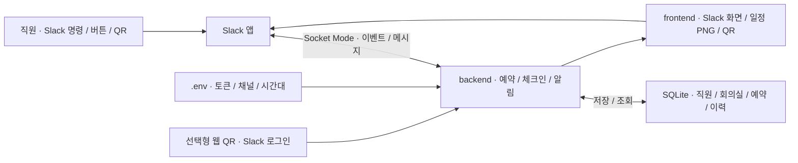

# Slack QR Check — Slack 회의실 예약·QR 체크인

## 소개

**Slack에서 회의실을 예약하고, 입구의 QR로 참석을 확인해 쓰지 않는 예약을 자동으로 비우는 앱입니다.** 직원·회의실·예약·체크인 기록은 실행 PC의 SQLite 파일에 보관합니다.

예를 들어 `/room 지금`으로 빈 방을 확인하고 예약한 뒤, 회의실 입구에서 QR을 스캔해 체크인합니다. 시작 후 10분까지 참석자 누구도 체크인하지 않으면 예약이 자동 취소됩니다. 이미 체크인한 회의에는 늦게 온 참석자도 합류할 수 있습니다.

[주요 기능](#주요-기능) · [아키텍처](#아키텍처) · [기술 스택](#기술-스택) · [처음 실행하기](#처음-실행하기) · [프로젝트 구조](#프로젝트-구조) · [문서 전체 목차](docs/README.md)

## 주요 기능

| 하고 싶은 일 | 사용 방법 |
|---|---|
| 회의실 현황·일정 확인 | `/room 지금`, `/room 9A 내일` 또는 Slack 앱 홈 |
| 빈 방 찾고 예약 | 미팅룸에서 날짜·시작·사용 시간을 고르고 예약 |
| 내 예약 관리 | `/room 내예약`, 참석자 추가·예약 취소 |
| 회의실에서 체크인 | 입구 QR → Slack 회의실 채널 → 체크인 버튼 |
| 쓰지 않는 예약 비우기 | 시작 10분 전부터 체크인 허용, 시작 후 10분까지 미체크인 시 자동 취소 |
| 이용 기록 확인 | 노쇼 통계·예약 취소·체크인 이력 조회 |
| 관리자 배정 | 겹치는 예약을 확인하고 사유와 함께 강제 배정 |

등록한 직원만 예약·체크인하며, 직원과 Slack 계정은 전체 이메일 주소 또는 지정한 사용자 ID로 연결합니다. 최초 DB에는 직원·예약 샘플을 자동으로 넣지 않습니다. 명령과 운영 규칙은 [상세 사용법](docs/USAGE.md#slack-사용법)을 참고하세요.

## 아키텍처

화면·업무 처리·저장이 어떤 역할을 맡는지 보여 주는 구성도입니다.



Socket Mode는 **앱이 Slack으로 연결을 열어 명령과 버튼 이벤트를 받는 방식**입니다. 기본 회의실 채널 QR에는 공개 웹 수신 주소가 필요하지 않습니다. 일정 PNG를 Slack에서 보여 주려면 HTTPS 이미지 주소가 필요하며, 주소가 없으면 글자 목록으로 표시합니다. 웹 QR 모드를 선택하면 HTTPS 주소와 Slack 로그인 설정이 추가로 필요합니다.

## 기술 스택

| 구분 | 기술 | 맡은 역할 |
|---|---|---|
| 실행 | Python 3.12 이상 · uv | 앱 실행과 잠금 파일 기준 의존성 설치 |
| Slack 연결 | Slack Bolt · Slack SDK | 명령·버튼·홈 이벤트 수신과 메시지 전송 |
| 화면 | Slack Block Kit · HTML | Slack 화면과 모바일 체크인 결과 표시 |
| 웹 | FastAPI · Uvicorn | 웹 QR 로그인·체크인·이미지·상태 확인 요청 처리 |
| 저장 | SQLite | 직원·회의실·예약·취소·체크인 기록 보관 |
| 시간 작업 | APScheduler | 리마인더·노쇼 취소·브리핑 실행 |
| 이미지 | Pillow · qrcode | 일정 PNG와 인쇄용 QR 생성 |

일반 실행에는 별도 DB 서버나 AI API 키가 필요하지 않습니다. 패키지 버전은 [pyproject.toml](pyproject.toml)과 [uv.lock](uv.lock)이 기준입니다. pip 설치용 [requirements.txt](requirements.txt)도 제공합니다.

## 처음 실행하기

준비물은 **Python 3.12 이상**, **Git·uv**, 앱을 설치할 수 있는 **Slack 워크스페이스 권한**, 쓰기 가능한 로컬 디스크입니다. 일정 이미지에는 한글 폰트도 필요합니다. 전체 준비물은 [설치 요구사항](docs/REQUIREMENTS.md)에 있습니다. Linux의 폰트 설치와 선택형 HTTPS 설정은 [상세 안내](docs/USAGE.md#설치와-실행)를 보세요.

```sh
git clone https://github.com/realmi-lab/slack_qr_check.git
cd slack_qr_check
uv sync --locked
cp .env.example .env
```

Windows PowerShell에서는 `cp` 대신 `Copy-Item .env.example .env`를 사용할 수 있습니다.

1. [slack_manifest.yaml](slack_manifest.yaml)로 Slack 앱을 만들고 설치합니다. 기본 채널 QR에서는 매니페스트의 예시 웹 로그인 항목을 제거하는 [설치 단계](docs/USAGE.md#slackqr-설정)를 먼저 확인하세요.
2. Socket Mode를 켜고, 봇 토큰과 `connections:write` 앱 토큰을 `.env`에 입력합니다.
3. 워크스페이스·앱 ID와 서로 다른 임의의 `SECRET_KEY`, `QR_SECRET`을 채웁니다.
4. 아래 설정 검사를 실행하고 DB를 준비합니다.

```sh
uv run --locked python -m backend.doctor
uv run --locked python -m backend.cli db init
```

[직원·회의실 등록 명령](docs/USAGE.md#로컬-정보-등록)으로 실제 정보를 넣은 뒤 실행합니다.

```sh
uv run --locked python -m backend.main
```

실행 로그의 `슬랙봇 연결됨`을 확인하고 Slack에서 `/room 지금`을 입력합니다. 채널 준비가 끝나면 `uv run --locked python -m backend.cli qr`로 인쇄용 `qr/index.html`을 만듭니다. 실행 PC와 봇 프로세스가 켜져 있어야 예약·체크인·알림을 처리합니다.

## 두 앱의 공통 설정

[면접 앱](https://github.com/realmi-lab/slack-interview-app)과 같은 설정 이름·읽기 순서·Slack 연결 구조를 사용합니다.

```dotenv
SLACK_BOT_TOKEN=
SLACK_APP_TOKEN=
SLACK_NOTIFY_CHANNEL=
APP_TIMEZONE=Asia/Seoul
SQLITE_PATH=./data/roombot.sqlite3
```

실행 환경변수가 루트 `.env`보다 우선합니다. `SLACK_NOTIFY_CHANNEL`은 회의실 앱에서는 노쇼 알림 채널로 선택 항목입니다. QR 비밀값·직원·회의실·웹 로그인은 이 앱에 추가로 필요한 설정입니다. [공통 설정 안내](docs/SLACK_SETUP.md)와 [.env.example](.env.example)을 기준으로 입력하세요.

## 업데이트·종료·백업

실행 중인 터미널에서 `Ctrl+C`로 종료한 뒤 업데이트합니다.

```sh
git pull --ff-only origin main
uv sync --locked
uv run --locked python -m backend.main
```

로컬 수정이 있거나 Git이 충돌을 알리면 강제로 덮어쓰지 않습니다. `.env`, SQLite 파일, 기존 `QR_SECRET`을 보존하세요. 비밀값을 바꾸면 인쇄한 QR이 무효가 될 수 있습니다. 실행 중 DB는 앱의 [백업 명령](docs/USAGE.md#저장백업운영)으로 보관합니다.

## 프로젝트 구조

```text
backend/       설정·Slack 연결·HTTP·예약·체크인·SQLite
frontend/      Slack 화면·모바일 HTML·일정 이미지·QR·이미지 자산
scripts/       선택형 자동 시작·터널 도구
tests/         예약·권한·체크인·노쇼·저장 회귀 검사
docs/          공통 설정·상세 사용·검증 기록
.env.example   공개 가능한 설정 예제
```

| 수정할 내용 | 시작할 파일 |
|---|---|
| 환경변수·Slack 연결 | [backend/config.py](backend/config.py), [backend/slack.py](backend/slack.py) |
| 명령·버튼 이벤트 | [backend/slack_app.py](backend/slack_app.py) |
| 예약·체크인 규칙 | [backend/bookings.py](backend/bookings.py), [backend/checkin.py](backend/checkin.py) |
| Slack·모바일 화면 | [frontend/slack_views.py](frontend/slack_views.py), [frontend/pages.py](frontend/pages.py) |
| 저장·마이그레이션 | [backend/db.py](backend/db.py), [backend/schema.sql](backend/schema.sql) |

다른 개발자·GPT의 작업 기준은 [AGENTS.md](AGENTS.md)를 따릅니다.

## 검증과 현재 한계

핵심 회귀 검사는 다음 명령으로 한 번 실행합니다.

```sh
uv run --locked python -m pytest -q
```

2026-11-10 코드 변경 검증에서 **28개 검사와 Linux CI가 통과**했습니다. 임시 DB와 Slack 대역을 사용했으며, 실제 워크스페이스의 토큰·권한·QR 동작을 모두 검증한 결과는 아닙니다. 검사 범위와 근거는 [검증 기록](docs/TEST_REPORT.md)에 정리했습니다.

회사 직원 정보와 예약을 저장하므로 `.env`·DB·로그·QR 토큰은 비공개로 보관합니다. Slack 메시지와 이미지 주소의 접근 범위는 워크스페이스·실행 환경에 맞춰 설정해야 합니다.

## 문서와 참고 자료

[문서 전체 목차](docs/README.md) · [설치 요구사항](docs/REQUIREMENTS.md) · [상세 사용·운영](docs/USAGE.md) · [Slack 공통 설정](docs/SLACK_SETUP.md)

README 구성은 [Code Management](https://github.com/realmi-lab/code_management#readme)의 소개·기능·구성도·기술 역할·실행 입구·검증 구분 방식을 참고했습니다. Slack 연결 방식은 [Socket Mode 공식 문서](https://docs.slack.dev/apis/events-api/using-socket-mode/)를 참고하세요.
